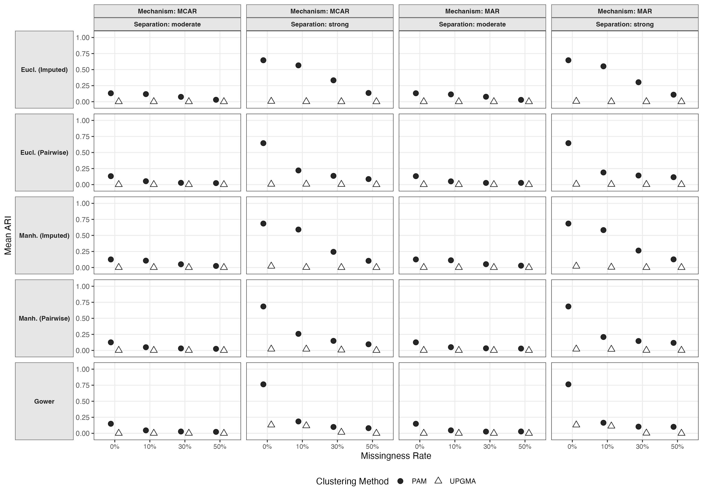

# Recovering Cluster Structure Under Missing Data

A simulation study of how the choice of proximity (distance) measure affects cluster recovery when data are incomplete. Originally developed as a graduate course project.

## Question

Which proximity measures best preserve a known cluster structure when the clustering variables have missing values, and does the answer depend on data type, missingness mechanism, and clustering algorithm?

## Design

| Factor | Levels |
| --- | --- |
| Data type | Continuous; mixed (continuous, ordinal, binary, and nominal variables) |
| Cluster separation | Moderate (2 SD), strong (4 SD) |
| Missingness mechanism | MCAR; MAR driven by a fully observed auxiliary variable that correlates with cluster membership |
| Missingness rate | 0% (complete-data baseline), 10%, 30%, 50% |
| Proximity measure | Euclidean and Manhattan after mean imputation; Euclidean and Manhattan on pairwise-available variables (rescaled); Gower dissimilarity |
| Clustering method | PAM (k-medoids) and UPGMA (average-linkage hierarchical), with k = 3 |

Each simulated dataset has three balanced clusters (n = 300) and five clustering variables. The design has 28 conditions with 300 replications each (8,400 replications). Cluster recovery is measured with the adjusted Rand index (ARI); the study also reports silhouette width and how often pairs of observations share no observed variables.

## Main findings

- Cluster recovery declined as missingness increased, most sharply at 50%.
- PAM recovered the true clusters more accurately than UPGMA across proximity measures.
- With continuous data and strong separation, mean-imputed Euclidean and Manhattan distances degraded gradually, while pairwise-available distances and Gower dissimilarity lost most of their accuracy at 10% missingness.
- Gower dissimilarity was competitive for mixed-type data but was not uniformly the best measure.
- Robustness was conditional: the missing-data strategy, proximity measure, and clustering algorithm interact. It is worth checking how well a measure preserves cluster structure under the missingness in your own data rather than defaulting to the conventional choice for a data type.



*Mean ARI by missingness rate for continuous data, by proximity measure (rows), mechanism and cluster separation (columns), and clustering method.*

## Limitations

The design is deliberately simple: three balanced clusters with k known, two separation levels, one MAR design, and mean imputation as a basic benchmark. Natural extensions include missing-not-at-random mechanisms, multiple imputation, and unbalanced or more complex cluster structures.

## Reproducing the results

Requires R (4.x) with MASS, cluster, mclust, ggplot2, dplyr, tidyr, and scales. `main.R` installs any that are missing.

Run the full study from the repository root:

```sh
Rscript main.R
```

The full simulation takes roughly 30 to 90 minutes on a laptop. For a quick test, set `RUN_DRY_RUN <- TRUE` in `main.R`.

To regenerate the figures and tables from the saved results without rerunning the simulation:

```r
pkgs <- c("MASS", "cluster", "mclust", "ggplot2", "dplyr", "tidyr", "scales")
invisible(lapply(pkgs, library, character.only = TRUE))
for (f in sprintf("R/0%d_%s.R", 1:7, c("generate_data", "missingness", "proximity",
                                        "clustering", "evaluation", "simulation", "results"))) {
  source(f)
}
results <- readRDS("output/simulation_results.rds")
create_all_outputs(results)
```

## Repository structure

```
main.R                              Runs the full study
R/01_generate_data.R                Simulates clustered data (continuous and mixed)
R/02_missingness.R                  Imposes MCAR and MAR missingness
R/03_proximity.R                    Computes the five proximity measures
R/04_clustering.R                   PAM and UPGMA clustering
R/05_evaluation.R                   ARI and silhouette width
R/06_simulation.R                   Runs replications across conditions
R/07_results.R                      Builds figures and summary tables
R/08_latex_tables.R                 Formats summary tables for LaTeX
R/optional_distance_comparison.R    Compares complete-data and incomplete-data distance matrices
output/simulation_results.rds       Saved simulation results
output/figures/                     Figures
output/tables/                      Summary tables
```

## License

Code is released under the MIT License (see `LICENSE`).
